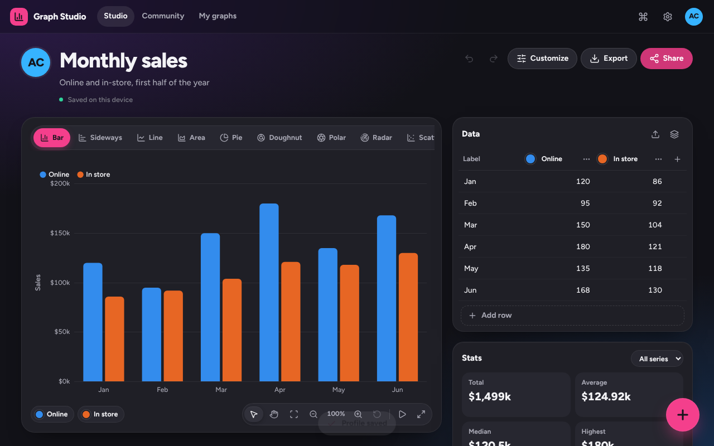
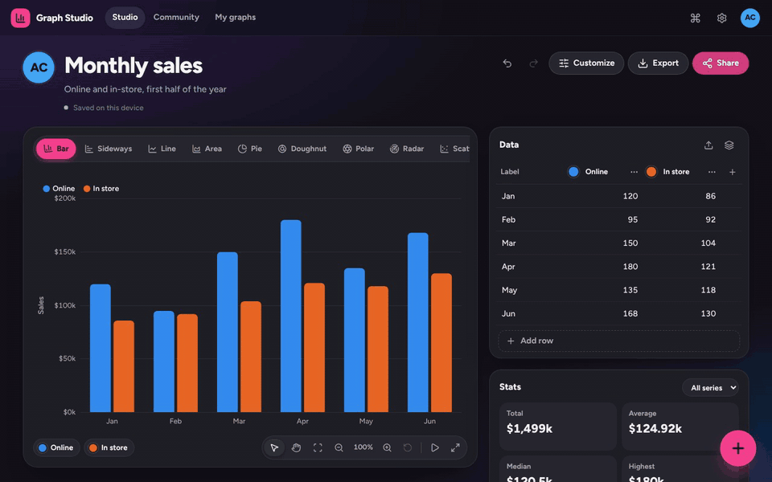
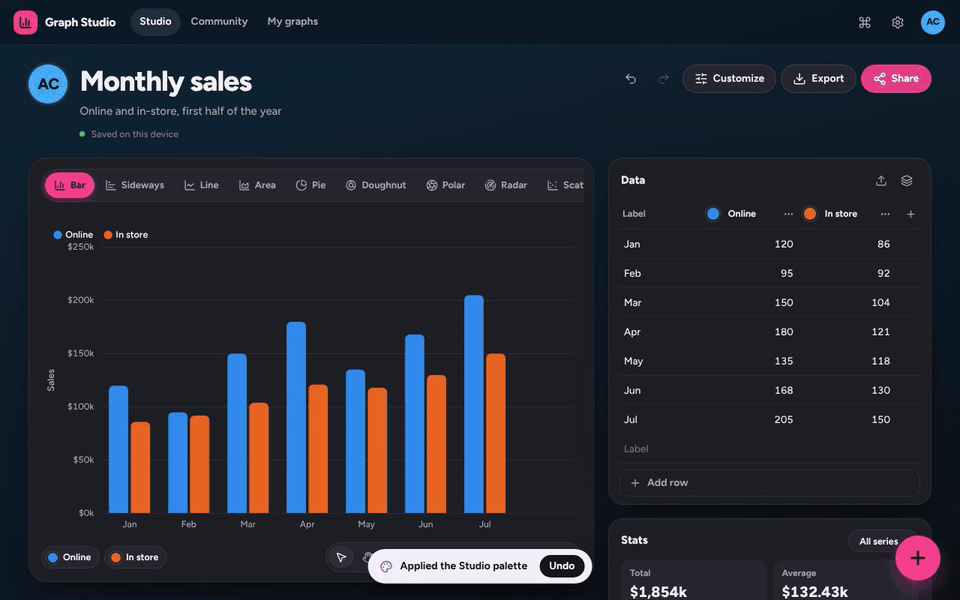
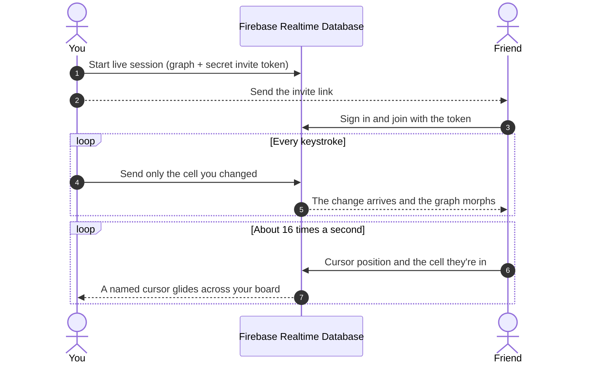
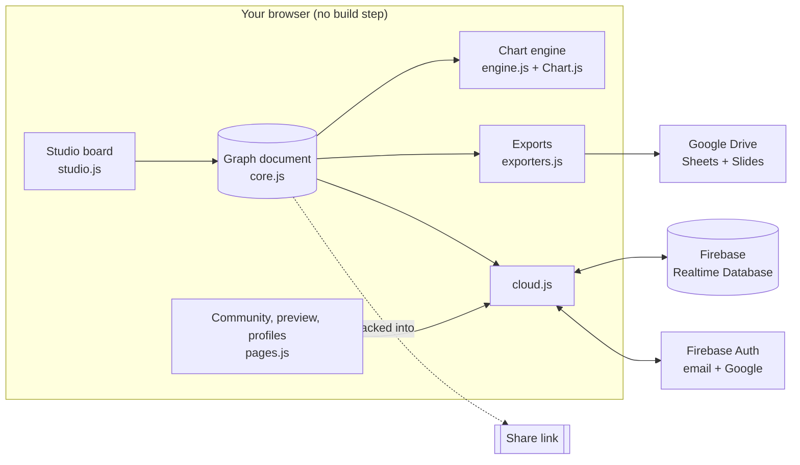
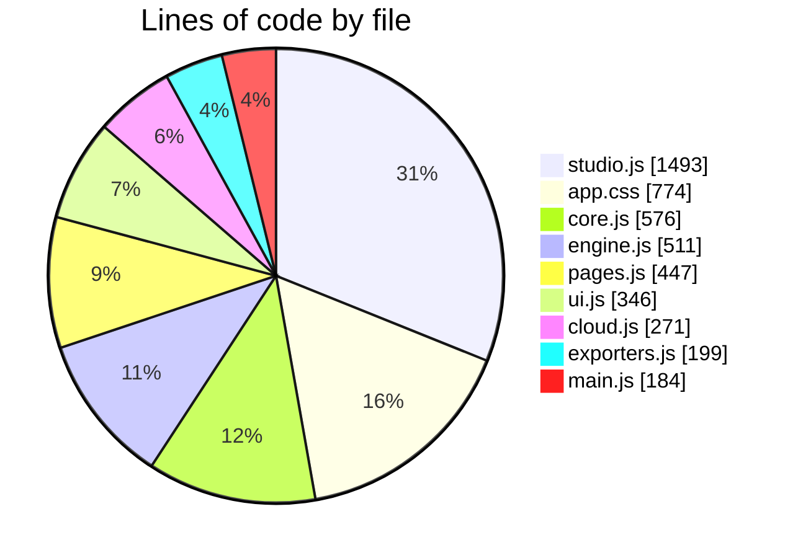

<div align="center">



<br>

<a href="#-put-it-online-in-five-minutes"></a>
<a href="SETUP.md"></a>
<a href="https://www.chartjs.org"></a>
<a href="https://firebase.google.com"></a>


### [Open the studio](https://your-site.netlify.app) &nbsp;·&nbsp; [Set it up](SETUP.md) &nbsp;·&nbsp; [Community wall](https://your-site.netlify.app/community)

<sub>A dark, Padlet-style board for making graphs that animate, share with one link, and let your friends edit with you, cursor and all.</sub>

</div>

<br>

<p align="center">
  
</p>

---

## ✦ Type a number. Watch it grow.

Hit the pink **+**, add a row, type a value. The graph doesn't redraw, it *morphs*: bars stretch, lines bend and slices swing into place while you type. Paste a whole table from Excel or Google Sheets and the series names come along with it.

<p align="center">
  
</p>

## ✦ Make it yours

<table>
  <tr>
    <td width="50%" valign="top">
      
      <h4>Every colour is your call</h4>
      Pick a palette or recolour any single series, bar or slice. Set a wallpaper for the board and the shared page, then choose how it enters: rise, cascade, pop, bounce, draw or spin.
    </td>
    <td width="50%" valign="top">
      
      <h4>Even the accent colour</h4>
      Pink not your thing? Settings → Accent colour repaints every button, highlight and the tab icon, with a smooth fade. Light accents get dark text automatically, so it always stays readable.
    </td>
  </tr>
</table>

## ✦ Everything in the box

<table>
  <tr>
    <td>📊 <b>Nine graph types</b><br><sub>Bar, sideways, line, area, pie, doughnut, polar, radar, scatter. Mix bars and lines in one graph.</sub></td>
    <td>🎨 <b>Your colours, not random ones</b><br><sub>8 palettes plus a colour picker on every series, bar and slice.</sub></td>
    <td>🔍 <b>Zoom and pan</b><br><sub>Scroll-zoom, drag to pan, box-zoom, and a live zoom readout.</sub></td>
  </tr>
  <tr>
    <td>📏 <b>A real scale panel</b><br><sub>Min, max, step, log scale, headroom, prefixes like $ and suffixes like k.</sub></td>
    <td>🏷️ <b>A legend you can click</b><br><sub>Position, alignment and markers. Chips under the graph hide or recolour series.</sub></td>
    <td>🎬 <b>Entrance animations</b><br><sub>Seven presets, with duration and easing. Shared links play them too.</sub></td>
  </tr>
  <tr>
    <td>🔗 <b>Share with one link</b><br><sub>No account needed. The graph travels inside the link itself.</sub></td>
    <td>🌍 <b>Community wall</b><br><sub>Publish with a name, description and your own link. Profiles get a photo and bio.</sub></td>
    <td>👥 <b>Edit together, live</b><br><sub>Named cursors, highlighted cells and emoji reactions, all as they happen.</sub></td>
  </tr>
  <tr>
    <td>📤 <b>Export anywhere</b><br><sub>PNG, CSV, PowerPoint, Google Sheets and Google Slides.</sub></td>
    <td>↩️ <b>Undo everything</b><br><sub>Every change, even in live sessions. Only yours, never your collaborator's.</sub></td>
    <td>⌨️ <b>Keyboard friendly</b><br><sub>A ⌘K command menu, spreadsheet-style Enter-to-next-row, and shortcuts for tools.</sub></td>
  </tr>
</table>

## ✦ Three ways to share

| | Who can see it | Needs an account | Stays up to date |
|---|---|:---:|:---:|
| 🔗 **Link** | Anyone with the link | No | No, it's a snapshot |
| 🌍 **Publish** | Everyone, on the community wall at `/graph/<your-link>/preview` | Yes | Yes, republish to update |
| 👥 **Live together** | People you invite | Yes | Yes, instantly |

> [!TIP]
> Published graphs get a mini website: the animated graph, the data table (hover a row to find it on the graph), quick stats, and a card for whoever made it. Add `?embed=1` to the link for a chart-only version you can put in an iframe.

## ✦ How live editing works



Cursors are pinned to parts of the board (the graph, the table, the stats) instead of raw screen pixels. A collaborator pointing at the March bar on a laptop is still pointing at it on your big monitor.

## ✦ Under the hood



Every edit is a small *patch* (path → new value). That one idea powers undo/redo, the local autosave, and live sync, since collaborators only ever exchange the bits that changed.

<details>
<summary><b>🥧 Where the code lives</b> (a pie chart, naturally)</summary>
<br>



</details>

<details>
<summary><b>🧊 Spin the sample graph in 3D</b> (drag it around)</summary>
<br>

The "Monthly sales" sample as a 3D model. GitHub lets you rotate and zoom it right here.

```stl
solid monthly_sales
  facet normal 0 0 -1
    outer loop
      vertex -3.00 -3.00 -1.50
      vertex -3.00 11.00 -1.50
      vertex 71.00 11.00 -1.50
    endloop
  endfacet
  facet normal 0 0 -1
    outer loop
      vertex -3.00 -3.00 -1.50
      vertex 71.00 11.00 -1.50
      vertex 71.00 -3.00 -1.50
    endloop
  endfacet
  facet normal 0 0 1
    outer loop
      vertex -3.00 -3.00 0.00
      vertex 71.00 -3.00 0.00
      vertex 71.00 11.00 0.00
    endloop
  endfacet
  facet normal 0 0 1
    outer loop
      vertex -3.00 -3.00 0.00
      vertex 71.00 11.00 0.00
      vertex -3.00 11.00 0.00
    endloop
  endfacet
  facet normal 0 -1 0
    outer loop
      vertex -3.00 -3.00 -1.50
      vertex 71.00 -3.00 -1.50
      vertex 71.00 -3.00 0.00
    endloop
  endfacet
  facet normal 0 -1 0
    outer loop
      vertex -3.00 -3.00 -1.50
      vertex 71.00 -3.00 0.00
      vertex -3.00 -3.00 0.00
    endloop
  endfacet
  facet normal 0 1 0
    outer loop
      vertex -3.00 11.00 -1.50
      vertex -3.00 11.00 0.00
      vertex 71.00 11.00 0.00
    endloop
  endfacet
  facet normal 0 1 0
    outer loop
      vertex -3.00 11.00 -1.50
      vertex 71.00 11.00 0.00
      vertex 71.00 11.00 -1.50
    endloop
  endfacet
  facet normal -1 0 0
    outer loop
      vertex -3.00 -3.00 -1.50
      vertex -3.00 -3.00 0.00
      vertex -3.00 11.00 0.00
    endloop
  endfacet
  facet normal -1 0 0
    outer loop
      vertex -3.00 -3.00 -1.50
      vertex -3.00 11.00 0.00
      vertex -3.00 11.00 -1.50
    endloop
  endfacet
  facet normal 1 0 0
    outer loop
      vertex 71.00 -3.00 -1.50
      vertex 71.00 11.00 -1.50
      vertex 71.00 11.00 0.00
    endloop
  endfacet
  facet normal 1 0 0
    outer loop
      vertex 71.00 -3.00 -1.50
      vertex 71.00 11.00 0.00
      vertex 71.00 -3.00 0.00
    endloop
  endfacet
  facet normal 0 0 -1
    outer loop
      vertex 0.00 0.00 0.00
      vertex 0.00 8.00 0.00
      vertex 8.00 8.00 0.00
    endloop
  endfacet
  facet normal 0 0 -1
    outer loop
      vertex 0.00 0.00 0.00
      vertex 8.00 8.00 0.00
      vertex 8.00 0.00 0.00
    endloop
  endfacet
  facet normal 0 0 1
    outer loop
      vertex 0.00 0.00 12.00
      vertex 8.00 0.00 12.00
      vertex 8.00 8.00 12.00
    endloop
  endfacet
  facet normal 0 0 1
    outer loop
      vertex 0.00 0.00 12.00
      vertex 8.00 8.00 12.00
      vertex 0.00 8.00 12.00
    endloop
  endfacet
  facet normal 0 -1 0
    outer loop
      vertex 0.00 0.00 0.00
      vertex 8.00 0.00 0.00
      vertex 8.00 0.00 12.00
    endloop
  endfacet
  facet normal 0 -1 0
    outer loop
      vertex 0.00 0.00 0.00
      vertex 8.00 0.00 12.00
      vertex 0.00 0.00 12.00
    endloop
  endfacet
  facet normal 0 1 0
    outer loop
      vertex 0.00 8.00 0.00
      vertex 0.00 8.00 12.00
      vertex 8.00 8.00 12.00
    endloop
  endfacet
  facet normal 0 1 0
    outer loop
      vertex 0.00 8.00 0.00
      vertex 8.00 8.00 12.00
      vertex 8.00 8.00 0.00
    endloop
  endfacet
  facet normal -1 0 0
    outer loop
      vertex 0.00 0.00 0.00
      vertex 0.00 0.00 12.00
      vertex 0.00 8.00 12.00
    endloop
  endfacet
  facet normal -1 0 0
    outer loop
      vertex 0.00 0.00 0.00
      vertex 0.00 8.00 12.00
      vertex 0.00 8.00 0.00
    endloop
  endfacet
  facet normal 1 0 0
    outer loop
      vertex 8.00 0.00 0.00
      vertex 8.00 8.00 0.00
      vertex 8.00 8.00 12.00
    endloop
  endfacet
  facet normal 1 0 0
    outer loop
      vertex 8.00 0.00 0.00
      vertex 8.00 8.00 12.00
      vertex 8.00 0.00 12.00
    endloop
  endfacet
  facet normal 0 0 -1
    outer loop
      vertex 12.00 0.00 0.00
      vertex 12.00 8.00 0.00
      vertex 20.00 8.00 0.00
    endloop
  endfacet
  facet normal 0 0 -1
    outer loop
      vertex 12.00 0.00 0.00
      vertex 20.00 8.00 0.00
      vertex 20.00 0.00 0.00
    endloop
  endfacet
  facet normal 0 0 1
    outer loop
      vertex 12.00 0.00 9.50
      vertex 20.00 0.00 9.50
      vertex 20.00 8.00 9.50
    endloop
  endfacet
  facet normal 0 0 1
    outer loop
      vertex 12.00 0.00 9.50
      vertex 20.00 8.00 9.50
      vertex 12.00 8.00 9.50
    endloop
  endfacet
  facet normal 0 -1 0
    outer loop
      vertex 12.00 0.00 0.00
      vertex 20.00 0.00 0.00
      vertex 20.00 0.00 9.50
    endloop
  endfacet
  facet normal 0 -1 0
    outer loop
      vertex 12.00 0.00 0.00
      vertex 20.00 0.00 9.50
      vertex 12.00 0.00 9.50
    endloop
  endfacet
  facet normal 0 1 0
    outer loop
      vertex 12.00 8.00 0.00
      vertex 12.00 8.00 9.50
      vertex 20.00 8.00 9.50
    endloop
  endfacet
  facet normal 0 1 0
    outer loop
      vertex 12.00 8.00 0.00
      vertex 20.00 8.00 9.50
      vertex 20.00 8.00 0.00
    endloop
  endfacet
  facet normal -1 0 0
    outer loop
      vertex 12.00 0.00 0.00
      vertex 12.00 0.00 9.50
      vertex 12.00 8.00 9.50
    endloop
  endfacet
  facet normal -1 0 0
    outer loop
      vertex 12.00 0.00 0.00
      vertex 12.00 8.00 9.50
      vertex 12.00 8.00 0.00
    endloop
  endfacet
  facet normal 1 0 0
    outer loop
      vertex 20.00 0.00 0.00
      vertex 20.00 8.00 0.00
      vertex 20.00 8.00 9.50
    endloop
  endfacet
  facet normal 1 0 0
    outer loop
      vertex 20.00 0.00 0.00
      vertex 20.00 8.00 9.50
      vertex 20.00 0.00 9.50
    endloop
  endfacet
  facet normal 0 0 -1
    outer loop
      vertex 24.00 0.00 0.00
      vertex 24.00 8.00 0.00
      vertex 32.00 8.00 0.00
    endloop
  endfacet
  facet normal 0 0 -1
    outer loop
      vertex 24.00 0.00 0.00
      vertex 32.00 8.00 0.00
      vertex 32.00 0.00 0.00
    endloop
  endfacet
  facet normal 0 0 1
    outer loop
      vertex 24.00 0.00 15.00
      vertex 32.00 0.00 15.00
      vertex 32.00 8.00 15.00
    endloop
  endfacet
  facet normal 0 0 1
    outer loop
      vertex 24.00 0.00 15.00
      vertex 32.00 8.00 15.00
      vertex 24.00 8.00 15.00
    endloop
  endfacet
  facet normal 0 -1 0
    outer loop
      vertex 24.00 0.00 0.00
      vertex 32.00 0.00 0.00
      vertex 32.00 0.00 15.00
    endloop
  endfacet
  facet normal 0 -1 0
    outer loop
      vertex 24.00 0.00 0.00
      vertex 32.00 0.00 15.00
      vertex 24.00 0.00 15.00
    endloop
  endfacet
  facet normal 0 1 0
    outer loop
      vertex 24.00 8.00 0.00
      vertex 24.00 8.00 15.00
      vertex 32.00 8.00 15.00
    endloop
  endfacet
  facet normal 0 1 0
    outer loop
      vertex 24.00 8.00 0.00
      vertex 32.00 8.00 15.00
      vertex 32.00 8.00 0.00
    endloop
  endfacet
  facet normal -1 0 0
    outer loop
      vertex 24.00 0.00 0.00
      vertex 24.00 0.00 15.00
      vertex 24.00 8.00 15.00
    endloop
  endfacet
  facet normal -1 0 0
    outer loop
      vertex 24.00 0.00 0.00
      vertex 24.00 8.00 15.00
      vertex 24.00 8.00 0.00
    endloop
  endfacet
  facet normal 1 0 0
    outer loop
      vertex 32.00 0.00 0.00
      vertex 32.00 8.00 0.00
      vertex 32.00 8.00 15.00
    endloop
  endfacet
  facet normal 1 0 0
    outer loop
      vertex 32.00 0.00 0.00
      vertex 32.00 8.00 15.00
      vertex 32.00 0.00 15.00
    endloop
  endfacet
  facet normal 0 0 -1
    outer loop
      vertex 36.00 0.00 0.00
      vertex 36.00 8.00 0.00
      vertex 44.00 8.00 0.00
    endloop
  endfacet
  facet normal 0 0 -1
    outer loop
      vertex 36.00 0.00 0.00
      vertex 44.00 8.00 0.00
      vertex 44.00 0.00 0.00
    endloop
  endfacet
  facet normal 0 0 1
    outer loop
      vertex 36.00 0.00 18.00
      vertex 44.00 0.00 18.00
      vertex 44.00 8.00 18.00
    endloop
  endfacet
  facet normal 0 0 1
    outer loop
      vertex 36.00 0.00 18.00
      vertex 44.00 8.00 18.00
      vertex 36.00 8.00 18.00
    endloop
  endfacet
  facet normal 0 -1 0
    outer loop
      vertex 36.00 0.00 0.00
      vertex 44.00 0.00 0.00
      vertex 44.00 0.00 18.00
    endloop
  endfacet
  facet normal 0 -1 0
    outer loop
      vertex 36.00 0.00 0.00
      vertex 44.00 0.00 18.00
      vertex 36.00 0.00 18.00
    endloop
  endfacet
  facet normal 0 1 0
    outer loop
      vertex 36.00 8.00 0.00
      vertex 36.00 8.00 18.00
      vertex 44.00 8.00 18.00
    endloop
  endfacet
  facet normal 0 1 0
    outer loop
      vertex 36.00 8.00 0.00
      vertex 44.00 8.00 18.00
      vertex 44.00 8.00 0.00
    endloop
  endfacet
  facet normal -1 0 0
    outer loop
      vertex 36.00 0.00 0.00
      vertex 36.00 0.00 18.00
      vertex 36.00 8.00 18.00
    endloop
  endfacet
  facet normal -1 0 0
    outer loop
      vertex 36.00 0.00 0.00
      vertex 36.00 8.00 18.00
      vertex 36.00 8.00 0.00
    endloop
  endfacet
  facet normal 1 0 0
    outer loop
      vertex 44.00 0.00 0.00
      vertex 44.00 8.00 0.00
      vertex 44.00 8.00 18.00
    endloop
  endfacet
  facet normal 1 0 0
    outer loop
      vertex 44.00 0.00 0.00
      vertex 44.00 8.00 18.00
      vertex 44.00 0.00 18.00
    endloop
  endfacet
  facet normal 0 0 -1
    outer loop
      vertex 48.00 0.00 0.00
      vertex 48.00 8.00 0.00
      vertex 56.00 8.00 0.00
    endloop
  endfacet
  facet normal 0 0 -1
    outer loop
      vertex 48.00 0.00 0.00
      vertex 56.00 8.00 0.00
      vertex 56.00 0.00 0.00
    endloop
  endfacet
  facet normal 0 0 1
    outer loop
      vertex 48.00 0.00 13.50
      vertex 56.00 0.00 13.50
      vertex 56.00 8.00 13.50
    endloop
  endfacet
  facet normal 0 0 1
    outer loop
      vertex 48.00 0.00 13.50
      vertex 56.00 8.00 13.50
      vertex 48.00 8.00 13.50
    endloop
  endfacet
  facet normal 0 -1 0
    outer loop
      vertex 48.00 0.00 0.00
      vertex 56.00 0.00 0.00
      vertex 56.00 0.00 13.50
    endloop
  endfacet
  facet normal 0 -1 0
    outer loop
      vertex 48.00 0.00 0.00
      vertex 56.00 0.00 13.50
      vertex 48.00 0.00 13.50
    endloop
  endfacet
  facet normal 0 1 0
    outer loop
      vertex 48.00 8.00 0.00
      vertex 48.00 8.00 13.50
      vertex 56.00 8.00 13.50
    endloop
  endfacet
  facet normal 0 1 0
    outer loop
      vertex 48.00 8.00 0.00
      vertex 56.00 8.00 13.50
      vertex 56.00 8.00 0.00
    endloop
  endfacet
  facet normal -1 0 0
    outer loop
      vertex 48.00 0.00 0.00
      vertex 48.00 0.00 13.50
      vertex 48.00 8.00 13.50
    endloop
  endfacet
  facet normal -1 0 0
    outer loop
      vertex 48.00 0.00 0.00
      vertex 48.00 8.00 13.50
      vertex 48.00 8.00 0.00
    endloop
  endfacet
  facet normal 1 0 0
    outer loop
      vertex 56.00 0.00 0.00
      vertex 56.00 8.00 0.00
      vertex 56.00 8.00 13.50
    endloop
  endfacet
  facet normal 1 0 0
    outer loop
      vertex 56.00 0.00 0.00
      vertex 56.00 8.00 13.50
      vertex 56.00 0.00 13.50
    endloop
  endfacet
  facet normal 0 0 -1
    outer loop
      vertex 60.00 0.00 0.00
      vertex 60.00 8.00 0.00
      vertex 68.00 8.00 0.00
    endloop
  endfacet
  facet normal 0 0 -1
    outer loop
      vertex 60.00 0.00 0.00
      vertex 68.00 8.00 0.00
      vertex 68.00 0.00 0.00
    endloop
  endfacet
  facet normal 0 0 1
    outer loop
      vertex 60.00 0.00 16.80
      vertex 68.00 0.00 16.80
      vertex 68.00 8.00 16.80
    endloop
  endfacet
  facet normal 0 0 1
    outer loop
      vertex 60.00 0.00 16.80
      vertex 68.00 8.00 16.80
      vertex 60.00 8.00 16.80
    endloop
  endfacet
  facet normal 0 -1 0
    outer loop
      vertex 60.00 0.00 0.00
      vertex 68.00 0.00 0.00
      vertex 68.00 0.00 16.80
    endloop
  endfacet
  facet normal 0 -1 0
    outer loop
      vertex 60.00 0.00 0.00
      vertex 68.00 0.00 16.80
      vertex 60.00 0.00 16.80
    endloop
  endfacet
  facet normal 0 1 0
    outer loop
      vertex 60.00 8.00 0.00
      vertex 60.00 8.00 16.80
      vertex 68.00 8.00 16.80
    endloop
  endfacet
  facet normal 0 1 0
    outer loop
      vertex 60.00 8.00 0.00
      vertex 68.00 8.00 16.80
      vertex 68.00 8.00 0.00
    endloop
  endfacet
  facet normal -1 0 0
    outer loop
      vertex 60.00 0.00 0.00
      vertex 60.00 0.00 16.80
      vertex 60.00 8.00 16.80
    endloop
  endfacet
  facet normal -1 0 0
    outer loop
      vertex 60.00 0.00 0.00
      vertex 60.00 8.00 16.80
      vertex 60.00 8.00 0.00
    endloop
  endfacet
  facet normal 1 0 0
    outer loop
      vertex 68.00 0.00 0.00
      vertex 68.00 8.00 0.00
      vertex 68.00 8.00 16.80
    endloop
  endfacet
  facet normal 1 0 0
    outer loop
      vertex 68.00 0.00 0.00
      vertex 68.00 8.00 16.80
      vertex 68.00 0.00 16.80
    endloop
  endfacet
endsolid monthly_sales
```

</details>

## ✦ Put it online in five minutes

It's free and there's no terminal anywhere. The full click-by-click guide is in **[SETUP.md](SETUP.md)**.

1. **Try it.** Double-click `index.html`. The studio works straight away.
2. **Create a Firebase project** on the free Spark plan and register a web app.
3. **Paste the config** into `js/config.js`. It's the only file you ever edit.
4. **Turn on the database.** Create a Realtime Database in locked mode and paste `database.rules.json` into its Rules tab.
5. **Turn on sign-in** with Email/Password and Google.
6. **Drag the folder** onto [Netlify Drop](https://app.netlify.com/drop), or upload it to GitHub Pages, then add your domain under Firebase → Authentication → Authorized domains.

> [!NOTE]
> Pretty links like `/graph/johncenagrades2025/preview` work on Netlify, GitHub Pages and Vercel out of the box (`_redirects`, `404.html` and `vercel.json` are included). Anywhere else, set `routing: "hash"` in `js/config.js`.

> [!IMPORTANT]
> The Firebase API key in `js/config.js` is meant to be public. What protects your data is `database.rules.json`, so make sure it's published.

<details>
<summary><b>🔐 What the security rules allow</b></summary>
<br>

| Data | Who can read | Who can write |
|---|---|---|
| Published graphs | Everyone | Only the person who published it |
| Profiles (name, photo, bio) | Everyone | Only that person |
| Usernames and graph links | Everyone | First come, first served. Nobody can take yours |
| Likes | Everyone | Each person likes only as themselves |
| Live graphs | Owner and invited members | Owner and invited members |
| Invite tokens | Members | The owner |
| Cursors and presence | Members | Each person only moves their own cursor |

</details>

## ✦ Keyboard shortcuts

<details>
<summary><b>⌨️ Show all shortcuts</b></summary>
<br>

| Keys | Does |
|---|---|
| <kbd>⌘</kbd> <kbd>K</kbd> | Command menu: type "pie", "export", "accent"… |
| <kbd>⌘</kbd> <kbd>Z</kbd> / <kbd>⇧</kbd> <kbd>⌘</kbd> <kbd>Z</kbd> | Undo / redo |
| <kbd>⌘</kbd> <kbd>E</kbd> | Export |
| <kbd>Enter</kbd> | Next row (adds one at the end) |
| <kbd>V</kbd> <kbd>H</kbd> <kbd>Z</kbd> | Point, pan, box-zoom |
| <kbd>Ctrl</kbd> + scroll | Zoom the graph |
| <kbd>F</kbd> | Focus mode |
| <kbd>R</kbd> | Replay the animation |
| <kbd>0</kbd> | Reset zoom |

On Windows, use <kbd>Ctrl</kbd> wherever you see <kbd>⌘</kbd>.

</details>

## ✦ Project map

<details>
<summary><b>📁 What each file does</b></summary>
<br>

```text
graph-studio/
├── index.html            the app shell
├── css/app.css           the dark board look, animations included
├── js/
│   ├── config.js         ← your Firebase config goes here (the only file you edit)
│   ├── core.js           the graph document, patches, storage, CSV, share-link packing
│   ├── engine.js         turns a graph into Chart.js, morphs it live, renders exports
│   ├── studio.js         the board: data grid, customize panel, + button, live cursors
│   ├── pages.js          sign-in, profiles, community wall, preview pages
│   ├── cloud.js          Firebase: accounts, publishing, likes, live graphs, presence
│   ├── exporters.js      PNG, CSV, project files, PowerPoint, Google Sheets/Slides
│   ├── ui.js             sheets, popovers, colour picker, toasts, confetti
│   ├── icons.js          the icon set
│   └── main.js           routing and the top bar
├── database.rules.json   paste into Firebase → Realtime Database → Rules
├── 404.html · _redirects · vercel.json   pretty links on static hosts
└── SETUP.md              the click-by-click setup guide
```

</details>

## ✦ Questions

<details>
<summary><b>Is it really free?</b></summary>
<br>
Yes. Hosting on Netlify or GitHub Pages is free, and Firebase's Spark plan covers the database and sign-in: 1 GB stored, 10 GB of downloads a month and 100 people connected at once. That's plenty for a class, a team or a small community.
</details>

<details>
<summary><b>Do I need Firebase to use it?</b></summary>
<br>
No. The studio, exports, share links and your saved graphs all work without it. Firebase only switches on accounts, the community wall, publishing and live editing.
</details>

<details>
<summary><b>Where are my graphs saved?</b></summary>
<br>
On your device (browser storage) until you publish or start a live session. Use <b>Export → Project file</b> to keep a copy you can open anywhere.
</details>

<details>
<summary><b>Can I put the graph in Google Slides?</b></summary>
<br>
Yes. Export → Google Slides or PowerPoint gives you a title slide, the graph and the data table. With the optional Google step in SETUP.md it creates the deck straight in your Drive. Otherwise, import the <code>.pptx</code> with File → Import slides.
</details>

<details>
<summary><b>What happens to my old Graph Studio data?</b></summary>
<br>
If you used the first version, your saved table is brought over automatically the first time you open this one.
</details>

## ✦ Built with

- [Chart.js](https://www.chartjs.org) and [chartjs-plugin-zoom](https://github.com/chartjs/chartjs-plugin-zoom) for the graphs (MIT)
- [Firebase](https://firebase.google.com) Auth and Realtime Database for accounts, community and live editing
- [PptxGenJS](https://gitbrent.github.io/PptxGenJS/) for PowerPoint files (MIT)
- [Lucide](https://lucide.dev) icon shapes (ISC) and the [Figtree](https://fonts.google.com/specimen/Figtree) typeface (SIL Open Font License)

<br>

<div align="center">
<sub>Made with Graph Studio. Now go make a graph that moves. &nbsp;<a href="#readme">Back to top ↑</a></sub>
</div>
